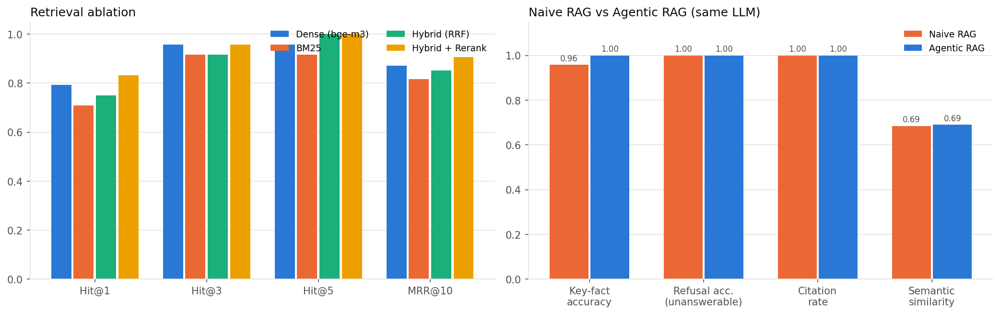
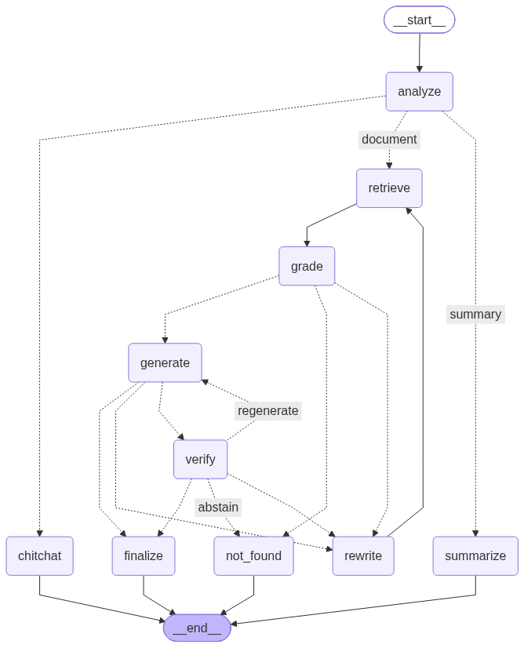

# Local Agentic RAG Chatbot for Any PDF

An open-source Agentic RAG chatbot that answers questions about any uploaded PDF. Every model runs locally on the free Google Colab T4 GPU, with no API keys.

**Deliverable:** [`Agentic_RAG_PDF_Chatbot.ipynb`](Agentic_RAG_PDF_Chatbot.ipynb)

## Quick start
1. Open the notebook in Google Colab.
2. **Runtime → Change runtime type → T4 GPU**.
3. **Runtime → Run all**.
4. Open the Gradio link printed in Section 8, upload a PDF and chat.

## Stack
| Part | Choice |
|---|---|
| LLM | `Qwen/Qwen3-4B-Instruct-2507` (FP16), auto-fallback to `Qwen2.5-3B-Instruct` |
| Parsing | PyMuPDF + pymupdf4llm (tables and headings as Markdown) + Tesseract OCR |
| Retrieval | `BAAI/bge-m3` dense + BM25 → Reciprocal Rank Fusion → `BAAI/bge-reranker-v2-m3` |
| Agent | LangGraph: route → decompose → retrieve → grade → rewrite (HyDE) → cited answer → verify → regenerate |
| UI | Gradio |
| Evaluation | Retrieval ablation (Hit@k, MRR) and Naive vs Agentic RAG (key-fact accuracy, LLM-judge, F1, semantic similarity, refusal accuracy, citation rate, latency, VRAM) |

## Results (Colab T4, "Attention Is All You Need" test set)
| Metric | Naive RAG | Agentic RAG |
|---|---|---|
| Key-fact accuracy (24 answerable questions) | 95.8% | **100%** |
| Unanswerable questions correctly refused | n/a | **5 / 5** |
| Retrieval Hit@1 | 0.75 (dense only) | **0.83** (hybrid + rerank) |

Both systems use the same LLM and answer prompt. Full tables, charts and per-question answers are in the notebook outputs and in [`results/`](results/).

## Agent workflow

## Repository layout
- `Agentic_RAG_PDF_Chatbot.ipynb`: the full pipeline, with comments and benchmarks
- `build_notebook.py`: source of the notebook. Edit this, then run `python build_notebook.py` to regenerate it.
- `results/`: benchmark CSVs, run info and chart from the Colab T4 run

## License
MIT
